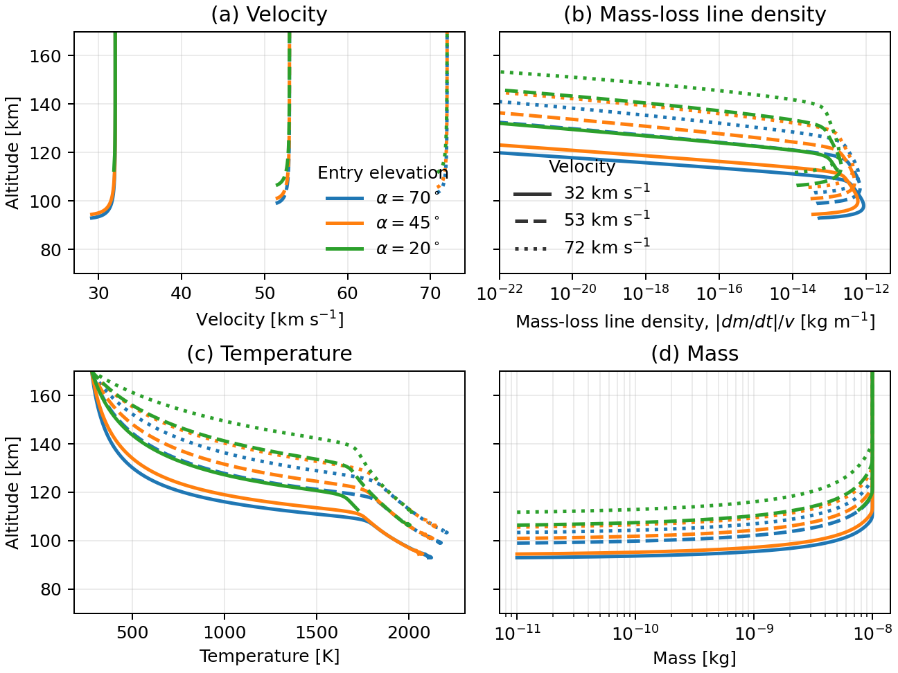

# Meteoroid Ablation Models

`metablate` provides meteoroid ablation and atmospheric-entry models, MSIS
atmospheres, material presets, and plasma-density calculations.

## Install

Install the latest published release:

```bash
pip install metablate
```

The bleeding-edge version is available with:

```bash
pip install git+https://github.com/danielk333/ablate.git
```

or trough cloning this repo.

## Minimal ablation example

Run the Kero–Szasz (2008) model with a cometary meteoroid and the default
`AtmPymsis` atmosphere:

```python
import numpy as np
from spacecoords import frames

import metablate.material as mat
import metablate.models.kero_szasz_2008 as ks

lat, lon = 67.0, 20.0
position = frames.geodetic_wgs84_to_ecef(lat, lon, 100e3, degrees=True)
direction = frames.azel_to_ecef(lat, lon, az=10, el=-45, degrees=True)

model = ks.KeroSzasz2008(
    options=ks.KeroSzaszOptions(
        material=mat.cometary,
        atmosphere_kwargs=dict(as_dataset=False),
    ),
)
result = model.run(
    parameters=ks.KeroSzaszInitialState(
        epoch=np.datetime64("2018-06-28T12:45:33"),
        position_ecef=position,
        velocity_ecef=direction * 60e3,
        mass=1e-6,
    ),
)
print(f"Runtime: {result.runtime:.3f} s")
```

Positions and velocities use ECEF coordinates in metres and metres per second;
mass is in kilograms. Results include time, mass, velocity, temperature and position.

## Atmospheres and computation

`AtmPymsis` uses `pymsis`, with MSIS 2.1 by default. Historical solar and geomagnetic
indices are downloaded and cached when not supplied. Setting `as_dataset=False`
in `atmosphere_kwargs` avoids constructing an xarray dataset at each solver step.

`AtmMSISE00` is optional and requires the separate `msise00` package and a Fortran
compiler; see its [installation instructions](https://github.com/space-physics/msise00#install).

Some functions use Numba to speed up subsequent calls. The first call
compiles the kernels, which are cached for subsequent runs. Set `NUMBA_DISABLE_JIT=1`
to run the same formulas in Python for debugging.

## Examples

See [docs/examples](docs/examples) for e.g. ablation, fireball, alpha–beta and plasma examples.
For example, after a repository checkout, generate an ablation sweep with:

```bash
python docs/examples/ablation_sweep.py --output ablation_sweep.png
```

Which produces this plot:



## Development

From a repository checkout:

```bash
pip install -e .[tests]
# or pip install -e .[develop] for all dev packages
pytest
```
